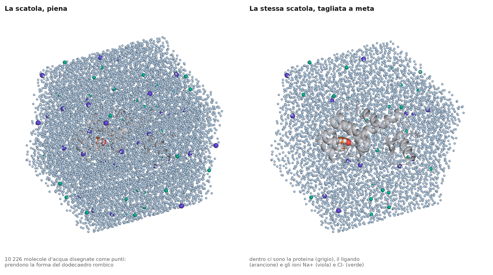
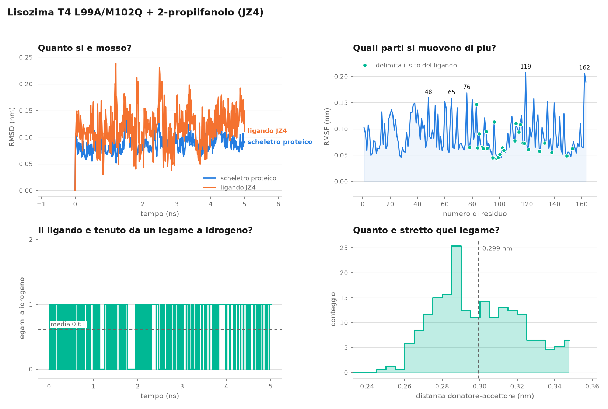

# Dinamica molecolare di un complesso proteina–ligando

### Esercitazione di quattro ore su Bombina

Partirai dalla struttura cristallografica di una proteina con una piccola
molecola legata, costruirai tutto ciò che serve alla simulazione, eseguirai una
breve traiettoria di dinamica molecolare e da questa misurerai tre cose: quanto
si è mossa la struttura, quali parti si sono mosse di più, e se il ligando è
rimasto legato alla proteina da un legame a idrogeno.



Il sistema è il **lisozima T4 L99A/M102Q con 2-propilfenolo**
([PDB 3HTB](https://www.rcsb.org/structure/3HTB)): 33 382 atomi in tutto, di
cui 2 636 sono la proteina e il ligando e tutto il resto è acqua e sale. È stato scelto perché è
abbastanza piccolo da arrivare in fondo in un pomeriggio su una macchina senza
scheda grafica, e perché porta con sé una domanda precisa, a cui saprai
rispondere alla fine:

> La proteina è un mutante ingegnerizzato. La Leu99 è stata accorciata ad
> alanina per scavare una cavità nel nucleo idrofobico, e la Met102 è stata
> sostituita da una glutammina per mettere in quella cavità un unico gruppo
> polare. L'ossidrile del ligando trova davvero quella glutammina, e ci resta?

---

## Il programma

| | | |
|---|---|---|
| 0:00 | [00 – Prima di iniziare](guida/00-prima-di-iniziare.md) | accesso, moduli, che cos'è un campo di forze |
| 0:20 | [01 – La struttura di partenza](guida/01-la-struttura-di-partenza.md) | che cosa c'è in un file PDB e che cosa va tolto |
| 0:45 | [02 – La topologia della proteina](guida/02-la-topologia-della-proteina.md) | `pdb2gmx`; che cosa contengono i file `.top` e `.gro` |
| 1:15 | [03 – Inserire il ligando](guida/03-inserire-il-ligando.md) | la parte che il campo di forze non conosce |
| 1:45 | [04 – Scatola, acqua, ioni](guida/04-scatola-acqua-ioni.md) | condizioni al contorno periodiche |
| 2:05 | [05 – Minimizzazione dell'energia](guida/05-minimizzazione.md) | integratori, raggi di taglio, PME |
| 2:25 | [06 – Equilibratura](guida/06-equilibratura.md) | NVT, NPT, termostati, barostati |
| 2:55 | [07 – Produzione e prestazioni](guida/07-produzione-e-prestazioni.md) | la simulazione vera; come accelerare `mdrun` |
| 3:20 | [08 – Analisi](guida/08-analisi.md) | RMSD, RMSF, legami a idrogeno, grafici |

Ogni pagina dice che cosa digitare, che cosa deve comparire, e spiega la teoria
nel punto in cui serve invece che tutta all'inizio.

---

## Prima di ogni altra cosa

```bash
ssh <tuo-username>@bombina.deb.unitus.it

git clone https://github.com/Upipp0/esercitazione-MD.git
cd esercitazione-MD

module use /modules
module load gromacs/2026.2
gmx --version | head -3
```

Se l'ultimo comando stampa `GROMACS version: 2026.2`, sei pronto.

> **Bombina non ha un sistema a code.** Ogni comando che digiti parte subito,
> sugli stessi 32 processori che sta usando tutta l'aula. La guida ti dice
> quanti thread chiedere a ogni passo. Non chiederne di più: una persona che si
> prende tutta la macchina blocca il lavoro di tutti gli altri, e l'esercizio è
> dimensionato in modo che non serva.

---

## Che cosa c'è in questo repository

| | |
|---|---|
| `guida/` | le nove pagine qui sopra — **questa è l'esercitazione** |
| `input/` | la struttura di partenza e i parametri del ligando, già pronti |
| `mdp/` | un file di impostazioni per ogni stadio, commentato riga per riga |
| `scripts/` | lo script dei grafici, uno di recupero e i comandi di analisi |
| `reference/` | una traiettoria di 5 ns già completata, con la sua analisi |
| `img/` | le figure della guida |
| `scripts/figure/` | gli script che le hanno prodotte |

Le figure non sono disegni: escono tutte da questa stessa simulazione, con
PyMOL e matplotlib. Se vuoi rifarle sulla *tua* traiettoria, gli script sono
lì e ciascuno dice in cima quali file gli servono. Per esempio:

```bash
pymol -cq scripts/figure/fig_minimizzazione.py -- run/solv_ions.gro run/em.gro img
```

**`reference/` è la tua rete di sicurezza.** L'analisi della pagina 08 si fa
sulla traiettoria che produci tu. Ma se la tua simulazione va lenta, o si
interrompe, o se vuoi semplicemente più dati di quanti ne diano 250 ps, tutti i
comandi funzionano identici su quella di riferimento: cambiano solo i nomi dei
file. Non resterai bloccato.

---

## Che cosa avrai alla fine

Una figura come questa, prodotta dalla tua simulazione:



e la capacità di spiegare che cosa significa ciascuno dei quattro pannelli.

---

### Una nota sui nomi delle cartelle

Le pagine della guida sono in italiano; i nomi delle cartelle (`input`, `mdp`,
`scripts`, `reference`) e quelli dei file sono rimasti in inglese, perché
compaiono dentro decine di comandi della guida e dentro gli script stessi.
Tradurli avrebbe significato avere comandi che non si possono copiare e
incollare.
