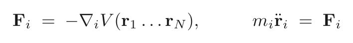
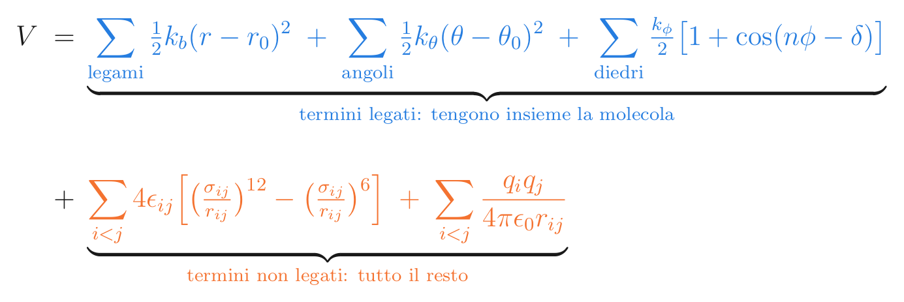

# 00 — Prima di iniziare

**Tempo: 20 minuti.**

---

## Accesso

```bash
ssh <tuo-username>@bombina.deb.unitus.it
```

Bombina è una singola macchina Linux con 16 core (32 thread hardware), 123 GB
di memoria e **nessuna scheda grafica**. Quest'ultimo punto conta più di ogni
altro in questa esercitazione: la dinamica molecolare moderna si fa normalmente
su GPU, che sono circa venti volte più veloci dei processori in questo compito.
Tutto quello che segue è dimensionato per arrivare in fondo sui soli processori.

Non c'è nemmeno **un sistema a code**. Su un cluster scriveresti uno script, lo
sottometteresti e aspetteresti il tuo turno. Qui qualunque cosa digiti parte
immediatamente e compete con il lavoro di tutti gli altri. Per questo la guida
ti dice quanti thread chiedere, e la risposta è quasi sempre due.

## Scaricare i file

```bash
git clone https://github.com/Upipp0/esercitazione-MD.git
cd esercitazione-MD
mkdir -p run
cd run
```

Lavorerai dentro `run/`, così i file che crei restano separati da quelli che
ti sono stati dati.

## Caricare GROMACS

GROMACS non è nel tuo path per impostazione predefinita. È installato come
*modulo*: software che accendi quando ti serve.

```bash
module use /modules          # dove Bombina tiene il suo software
module load gromacs/2026.2   # accendi GROMACS
gmx --version | head -20
```

Dovresti vedere:

```
GROMACS version:     2026.2
Precision:           mixed
MPI library:         thread_mpi
OpenMP support:      enabled
GPU support:         disabled
SIMD instructions:   AVX_512
```

Due righe vale la pena leggerle adesso, e torneranno alla pagina 07.
`GPU support: disabled` è il vincolo sotto cui stai lavorando.
`SIMD instructions: AVX_512` è il compenso: questa versione sa far eseguire a
ogni core sedici operazioni aritmetiche per volta, ed è il motivo per cui una
simulazione sui soli processori è lenta e non disperata.

Se apri un nuovo terminale più tardi devi ricaricare il modulo. Entrambe le
righe `module`, ogni volta.

---

## Che cosa stai per fare, e perché servono quattro passi

Nella sostanza, una simulazione di dinamica molecolare fa una cosa sola.
Conosci la posizione di ogni atomo. Hai una regola che, date tutte le
posizioni, ti dice che forza agisce su ciascun atomo. Allora: la forza cambia
la velocità, la velocità cambia la posizione, e si ricomincia. Qualche
centinaio di milioni di volte.

<p align="center"></p>

Sono la seconda legge di Newton e la definizione di forza come derivata
dell'energia potenziale. Nient'altro.

Tutta la difficoltà sta in quella $V$, l'energia potenziale: è lei che dice
quanto costa, in energia, una certa disposizione degli atomi. La funzione $V$
insieme alle molte migliaia di numeri che la riempiono si chiama **campo di
forze** (*force field*). Vale la pena guardarla una volta, perché quasi tutto
quello che farai oggi consiste nel procurarle i numeri che le servono:

<p align="center"></p>

Letta a parole, dice quattro cose.

- **I legami sono molle.** Allontana due atomi legati dalla loro distanza di
  equilibrio $r_0$ e l'energia sale come per una molla.
- **Gli angoli sono molle.** Stessa storia per l'ampiezza fra tre atomi in
  fila.
- **Ruotare attorno a un legame costa energia, in modo periodico.** È il
  termine dei diedri: girando di 360° si ripassa dalle stesse configurazioni.
- **Gli atomi non legati si sentono comunque**: si respingono con violenza
  quando si toccano, si attraggono debolmente quando sono vicini (è il termine
  di Lennard-Jones), e si attraggono o si respingono secondo la carica (è la
  legge di Coulomb).

Conta anche quello che nella formula **non** c'è: non ci sono elettroni, e
nessun legame può rompersi o formarsi. Un campo di forze è una caricatura
meccanica di una molecola, costruita per riprodurre la chimica quantistica e
l'esperimento sulle molecole con cui è stato messo a punto. Descrive molto bene
come una molecola cambia forma; non sa fare chimica.

Il campo di forze che useremo per la proteina si chiama **amber99sb-ildn**, ed
è una delle scelte standard per le proteine. Conosce tutti e venti gli
amminoacidi: dategli un nome di residuo e un nome di atomo e sa dire di che
atomo si tratta, quanto pesa, che carica porta, a chi è legato e con quali
parametri.

Del 2-propilfenolo, invece, non sa niente: non è un amminoacido e nessuno lo
ha mai messo in quella tabella. È per questo che esiste la pagina 03.

---

## I quattro passi, e perché servono tutti

| | | |
|---|---|---|
| **1. Topologia** | pagine 02–03 | Dire che cosa *è* ogni atomo. Il PDB dà le posizioni; la topologia dà cariche, masse, legami e quali parametri del campo di forze si applicano. Senza, non ci sono forze. |
| **2. Solvatazione** | pagina 04 | Una proteina nel vuoto non è una proteina. Mettila in una scatola d'acqua con sale fisiologico. |
| **3. Equilibratura** | pagine 05–06 | Il sistema assemblato non è all'equilibrio: gli atomi si sovrappongono, l'acqua è su un reticolo, nessuno ha una velocità sensata. Risolvi le sovrapposizioni, scaldalo, portalo alla densità giusta. |
| **4. Produzione e analisi** | pagine 07–08 | Solo adesso la traiettoria vale la pena di essere conservata. |

I passi 1–3 sono preparazione e occupano la maggior parte della giornata. È
rappresentativo: nel lavoro vero, preparare correttamente una simulazione
richiede molto più tempo che eseguirla, e la maggior parte delle simulazioni
che producono risultati senza senso lo fanno per un errore commesso al passo 1.

---

Avanti: [01 — La struttura di partenza](01-la-struttura-di-partenza.md)
