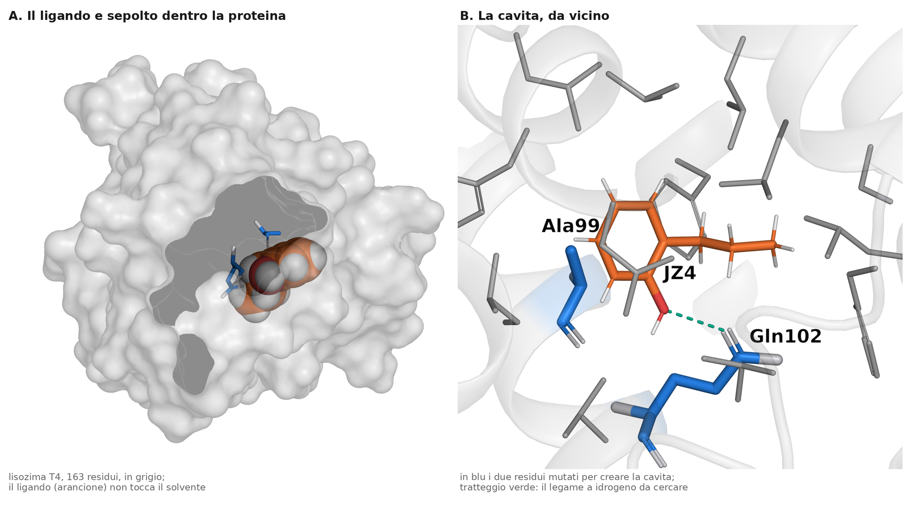
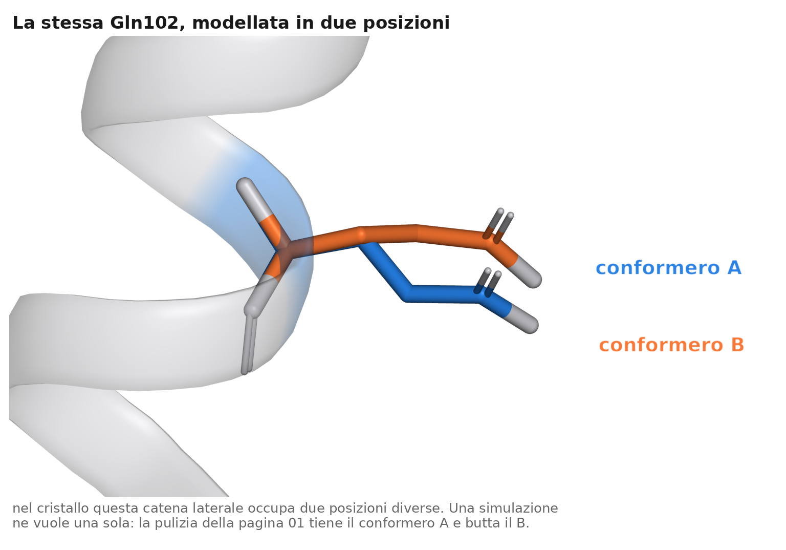

# 01 — La struttura di partenza

**Tempo: 25 minuti.**

---

## Di che cosa è fatto il sistema



La proteina è il **lisozima del batteriofago T4**, 163 amminoacidi. Non è il
lisozima in sé a interessarci: questa è una variante costruita in laboratorio
apposta per studiare come una piccola molecola si lega dentro una proteina.

Due amminoacidi sono stati cambiati, e sono quelli in blu nella figura.

- **Leu99 → Ala** (L99A). La leucina ha una catena laterale voluminosa;
  l'alanina ce l'ha minuscola. Accorciarla lascia un buco: una **cavità
  vuota** nel cuore idrofobico della proteina, grande quanto una piccola
  molecola organica.
- **Met102 → Gln** (M102Q). La cavità appena creata è tutta apolare. Mettendoci
  dentro una glutammina si aggiunge **un solo gruppo polare**, capace di fare
  un legame a idrogeno.

Il ligando, il **2-propilfenolo** (sigla `JZ4` nel file PDB), sta dentro quella
cavità. È una molecola quasi tutta apolare, tranne per un ossidrile.
La domanda dell'esperimento, in fondo, è questa: quell'ossidrile andrà a cercare la
glutammina?

---

## Che cosa c'è dentro il file

```bash
cd ~/esercitazione-MD/run
cp ../input/3HTB.pdb .
head -5 3HTB.pdb
```

```
HEADER    HYDROLASE                               11-JUN-09   3HTB
TITLE     2-PROPYLPHENOL IN COMPLEX WITH T4 LYSOZYME L99A/M102Q
```

È una struttura cristallografica a raggi X a 1,9 Å di risoluzione. Prima di
usarla, scopri che cosa contiene davvero:

```bash
grep -c '^ATOM'   3HTB.pdb      # 1364  -- la proteina
grep '^HETATM' 3HTB.pdb | cut -c18-20 | sort | uniq -c
```

```
      4 BME
    220 HOH
     10 JZ4
     10 PO4
```

Quindi il file contiene la proteina, **220 molecole d'acqua cristallografiche**,
**due ioni fosfato** e un **β-mercaptoetanolo** avanzati dal tampone di
cristallizzazione, e quello che ci interessa: **JZ4**, i dieci atomi del
2-propilfenolo.

### Anatomia di una riga PDB

Un file PDB è a **formato fisso**: il significato di un carattere dipende dalla
colonna in cui si trova, non da quanti spazi lo precedono. È per questo che si
tagliano colonne invece di separare sugli spazi.

```
HETATM 1385  OAB JZ4 A 167      23.412 -23.536  -4.342  1.00 13.88           O
|----| |---| |--||--|||---|     |-----| |-----| |-----| |--| |---|           ||
1-6    7-11  13-16 18-20 23-26  31-38   39-46   47-54   55-60 61-66          77-78
record seriale nome  resName     x       y       z       occ   B-factor      elemento
             altLoc┘  │chainID┘
                      resSeq
```

| colonne | campo | che cos'è |
|---|---|---|
| 1–6 | tipo di record | `ATOM` per il polimero biologico, `HETATM` per tutto il resto |
| 7–11 | seriale | numero dell'atomo |
| 13–16 | nome dell'atomo | **unico all'interno del residuo**, es. `CA`, `OAB` |
| 17 | altLoc | indicatore di posizione alternativa — vedi sotto |
| 18–20 | nome del residuo | `MET`, `HOH`, `JZ4` |
| 22 | catena | `A` |
| 23–26 | numero di residuo | all'interno della catena |
| 31–54 | x, y, z | **in ångström** |
| 55–60 | occupanza | in quale frazione del cristallo l'atomo sta lì |
| 61–66 | fattore B | quanto era sfumata la densità elettronica |

Tre cose mancano da quell'elenco, e conteranno tutte e tre:

1. **Niente idrogeni.** I raggi X diffondono sugli elettroni, e l'idrogeno ne
   ha uno. A 1,9 Å non si vedono. Circa metà degli atomi della tua simulazione
   non esiste ancora in questo file.
2. **Niente legami.** Il file dice dove sono gli atomi, non che cosa è attaccato
   a che cosa.
3. **Niente cariche, masse, tipi atomici.** Niente di ciò che serve al campo di
   forze.

Fornire tutte e tre queste cose è ciò che significa "costruire una topologia".

### Posizioni alternative

```bash
grep '^ATOM' 3HTB.pdb | cut -c17 | sort | uniq -c
```

```
   1236
     64 A
     64 B
```

Sessantaquattro atomi compaiono **due volte**, una con `A` in colonna 17 e una
con `B`. Succede perché un cristallo contiene miliardi di copie della stessa proteina,
e una catena laterale flessibile può essere orientata in un modo in alcune
copie e in un altro modo nelle altre. La densità elettronica le mostra
entrambe, e il cristallografo le ha modellate entrambe.



Una simulazione non può avere un atomo in due posti. Devi sceglierne uno. Tieni
`A` (per convenzione è quella a occupanza maggiore). Se te ne dimentichi,
`pdb2gmx` alla pagina successiva si fermerà con un errore di atomo duplicato.

```bash
grep '^ATOM' 3HTB.pdb | awk 'substr($0,17,1)!=" "' | cut -c18-27 | sort -u
```

```
ARG A 154   ARG A  80   ARG A  96   ASN A  68   ASP A  72
GLN A 102   LYS A 147   MET A   1   THR A  21   TYR A  24
```

Nota che **la Gln102 è fra queste** — proprio il residuo di cui parla tutto
l'esperimento. Quale dei due conformeri tenere non è una scelta banale;
prendiamo `A`, e la simulazione è poi libera di muoverlo.

---

## Decidere che cosa tenere

| nel file | tenerlo? | perché |
|---|---|---|
| proteina, catena A | **sì** | è la cosa che si simula |
| JZ4 | **sì** | è l'altra cosa che si simula |
| 220 HOH | **no** | stiamo per aggiungerne diecimila nostre, alla densità giusta e con le velocità |
| 2 × PO4 | **no** | tampone. Non fa parte della domanda, e ciascuno richiederebbe parametri propri |
| BME | **no** | tampone |
| altLoc B | **no** | non puoi tenerli entrambi |
| idrogeni | *assenti* | li costruirà `pdb2gmx` |

Una scelta che vale la pena notare: tenere le acque cristallografiche a volte è
la decisione *giusta*, quando un'acqua è sepolta nella proteina ed è
chiaramente strutturale. Qui sono tutte in superficie, quindi vanno via.

---

## Fare la pulizia

Proteina e ligando vanno separati, perché saranno trattati da macchinari
completamente diversi: la proteina da un campo di forze che la conosce già, il
ligando con parametri che forniamo a mano.

```bash
awk '/^ATOM/ && substr($0,22,1)=="A" && (substr($0,17,1)==" " || substr($0,17,1)=="A") {
       print substr($0,1,16) " " substr($0,18)
     }
     END {print "END"}' 3HTB.pdb > protein.pdb

awk '/^HETATM/ && substr($0,18,3)=="JZ4" {
       print substr($0,1,16) " " substr($0,18)
     }
     END {print "END"}' 3HTB.pdb > jz4_crystal.pdb
```

Leggi il primo pezzo per pezzo:

- `/^ATOM/` — solo la proteina, il che scarta in un colpo tutti gli `HETATM`;
- `substr($0,22,1)=="A"` — catena A;
- `substr($0,17,1)==" " || =="A"` — nessuna posizione alternativa, oppure il
  conformero A;
- `print substr($0,1,16) " " substr($0,18)` — copia la riga ma svuota la
  colonna 17, perché una volta tolto il conformero B l'etichetta `A` è una
  bugia, e alcuni programmi trattano un altLoc non vuoto come un avvertimento.

Controlla:

```bash
grep -c '^ATOM' protein.pdb          # 1300  = 1364 - 64 (i conformeri B)
grep -c '^HETATM' jz4_crystal.pdb    # 10
grep '^ATOM' protein.pdb | cut -c23-27 | sort -un | wc -l   # 163 residui
```

> Se uno di questi numeri è diverso, fermati e scopri perché prima di andare
> avanti. Un errore qui si propaga silenziosamente in tutto il resto.

---

## Com'è fatto il ligando

```bash
cat jz4_crystal.pdb
```

Dieci atomi pesanti: `C4 C7 C8 C9 C10 C11 C12 C13 C14 OAB`. Nove carboni e un
ossigeno — C₉H₁₂O, 2-propilfenolo. I dodici idrogeni mancano, come previsto.

L'anello è C7–C8–C9–C10–C12–C11, l'ossigeno ossidrilico `OAB` pende da C10, e
la catena propilica C13–C14–C4 pende da C12, che è adiacente a C10. Da qui
*2*-propilfenolo: il gruppo propilico sta sul carbonio adiacente a quello che
porta l'OH.

---

Avanti: [02 — La topologia della proteina](02-la-topologia-della-proteina.md)
