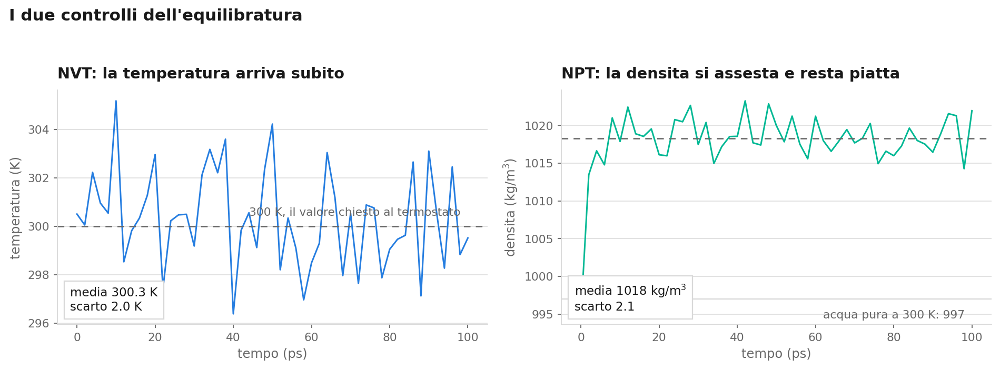

# 06 — Equilibratura: prima NVT, poi NPT

**Tempo: 30 minuti**, di cui il calcolatore ne usa circa 13.

La minimizzazione ha tolto le sovrapposizioni ma ti ha lasciato una struttura a
**temperatura zero**: ogni atomo fermo sul fondo di una buca di energia locale.
L'equilibratura porta il sistema alle condizioni che vuoi davvero simulare —
300 K e 1 bar — in due stadi, e lo fa tenendo fermo il soluto, così che sia il
solvente ad adattarsi.

---

## Prima di tutto: un file di indice

I file `.mdp` si riferiscono a due gruppi di atomi per nome, e uno dei due non
esiste ancora.

```bash
gmx make_ndx -f solv_ions.gro -o index.ndx
```

Stampa i gruppi che conosce e aspetta:

```
  0 System              : 33382 atoms
  1 Protein             :  2614 atoms
 13 JZ4                 :    22 atoms
 20 Water_and_ions      : 30746 atoms
```

Digita queste tre righe:

```
1 | 13
name 21 Protein_JZ4
q
```

`1 | 13` è l'unione insiemistica: un nuovo gruppo che contiene la proteina **e**
il ligando. `name 21 Protein_JZ4` gli dà un nome, e `q` salva ed esce.

### Perché proteina e ligando devono stare nello stesso gruppo

Il termostato non agisce sul sistema nel suo complesso. Agisce sui **gruppi di
accoppiamento termico**, ciascuno con il proprio termometro e la propria
correzione. Se dessi al ligando un gruppo tutto suo, staresti chiedendo a
GROMACS di misurare la temperatura di 22 atomi.

La temperatura è una proprietà di una distribuzione, e 22 atomi sono un
campione troppo piccolo: il valore istantaneo fluttuerebbe di decine di kelvin,
il termostato inseguirebbe il rumore e il ligando verrebbe perturbato in modo
sistematico. La disposizione standard è **due gruppi — soluto e solvente — e
non meno**.

---

## NVT: sistemare la temperatura

```bash
gmx grompp -f ../mdp/nvt.mdp -c em.gro -r em.gro -p topol.top -n index.ndx -o nvt.tpr
gmx mdrun -deffnm nvt -nt 2
```

Circa 6 minuti su due thread. Nota le opzioni nuove:

| | |
|---|---|
| `-r em.gro` | la struttura di **riferimento** per i vincoli posizionali. È separata da `-c` perché in generale si possono vincolare gli atomi verso una struttura diversa da quella di partenza. Obbligatoria ogni volta che i vincoli sono attivi |
| `-n index.ndx` | i gruppi che hai appena costruito |

`grompp` stampa una nota, attesa e innocua:

```
NOTE 1 [file nvt.mdp]:
  Removing center of mass motion in the presence of position restraints
  might cause artifacts.
```

I vincoli già impediscono al soluto di andare alla deriva, quindi togliere
anche il moto del centro di massa è un lieve doppio conteggio. Su 100 ps di
equilibratura non ha importanza.

### Che cosa significa NVT

**N** numero di particelle fisso, **V** volume fisso, **T** temperatura fissa.
La scatola non cambia dimensione; un termostato tiene la temperatura a 300 K.

Perché non fare semplicemente dinamica newtoniana? Perché la dinamica
newtoniana conserva l'*energia*, non la temperatura, e tu non sai in anticipo
quale energia totale corrisponda a 300 K per questo sistema. E soprattutto: una
proteina vera sta in un bagno termico — il resto della cellula — che fornisce e
assorbe energia. Un termostato è il modello di quel bagno.

### Le impostazioni che lo fanno

```
tcoupl   = v-rescale
tc-grps  = Protein_JZ4 Water_and_ions
tau-t    = 0.1 0.1
ref-t    = 300 300
pcoupl   = no
gen-vel  = yes
gen-temp = 300
```

**`gen-vel = yes`** assegna a ogni atomo una velocità casuale estratta dalla
distribuzione di Maxwell–Boltzmann a 300 K. È il momento in cui la simulazione
acquista energia cinetica. (Ciascuno avrà un seme casuale diverso, quindi la
tua traiettoria divergerà da quella del tuo vicino entro pochi picosecondi. Non
è un difetto: è il motivo per cui le simulazioni di produzione si ripetono.)

**`tcoupl = v-rescale`** è il riscalamento delle velocità con un termine
stocastico (Bussi, Donadio e Parrinello, 2007). Il termostato ingenuo
moltiplica tutte le velocità per un fattore che spinge la temperatura verso il
bersaglio: è il termostato di Berendsen, che funziona ma dà la **distribuzione
sbagliata** delle temperature — sopprime le fluttuazioni che un vero insieme
canonico possiede. `v-rescale` aggiunge un termine casuale scelto con cura che
le ripristina, così campiona il vero insieme canonico restando robusto quanto
Berendsen. Usa questo. Berendsen è deprecato in GROMACS e avvisa se lo chiedi.

**`tau-t = 0.1`** ps è la rapidità con cui il termostato agisce. Troppo piccolo
e smorzi la dinamica vera; troppo grande e l'equilibratura non finisce più.
0,1 ps è una scelta normale per l'equilibratura; 0,5–2 ps è più usuale in
produzione.

**`pcoupl = no`** — questa è la V di NVT. Volume fisso.

### Controlla che abbia funzionato

```bash
gmx energy -f nvt.edr -o temperature.xvg <<< "Temperature"
```

```
Energy              Average   Err.Est.      RMSD   Tot-Drift
-----------------------------------------------------------
Temperature         300.017       0.27   2.93459    1.59394  (K)
```



I due grafici vanno letti in modo diverso, ed è il motivo per cui sono messi
uno accanto all'altro. La temperatura **arriva subito** al valore giusto e poi
oscilla parecchio; la densità **ci mette di più** ad arrivare ma, una volta
arrivata, è quasi immobile.

Vuoi la media a 300 e la deriva piccola. Un RMSD di ±3 K in un sistema di
queste dimensioni è giusto, non un fallimento: l'ampiezza relativa delle
fluttuazioni di temperatura va come $1/\sqrt{N}$, e
$\sqrt{33382} \approx 183$, quindi una fluttuazione di qualche decimo di punto
percentuale è esattamente quello che la meccanica statistica prevede. **La
temperatura è una proprietà di una distribuzione; un singolo istante non ne ha
una.**

---

## NPT: sistemare la densità

```bash
gmx grompp -f ../mdp/npt.mdp -c nvt.gro -r nvt.gro -t nvt.cpt -p topol.top -n index.ndx -o npt.tpr
gmx mdrun -deffnm npt -nt 2
```

Altri 6 minuti. Una nuova opzione:

| | |
|---|---|
| `-t nvt.cpt` | il checkpoint di NVT. Porta con sé le **velocità** e lo stato esatto del termostato, così NPT continua invece di ricominciare |

e, corrispondentemente, nel `.mdp`: `gen-vel = no` e `continuation = yes`.

### Che cosa aggiunge NPT

**N** particelle, **P** pressione, **T** temperatura — e il volume adesso è
libero di cambiare. È l'insieme in cui si trova davvero un esperimento di
laboratorio: un campione a pressione atmosferica, libero di espandersi.

Conta perché `gmx solvate` ha riempito la scatola con acqua a una densità
*indovinata*. La densità vera che amber99sb-ildn + tip3p producono a 300 K e
1 bar è leggermente diversa. Esegui la produzione in una scatola densa il 2 %
di troppo e starai simulando una proteina sotto qualche centinaio di bar.

```
pcoupl           = c-rescale
pcoupltype       = isotropic
tau-p            = 1.0
ref-p            = 1.0
compressibility  = 4.5e-5
refcoord-scaling = com
```

**`pcoupl = c-rescale`** è il riscalamento stocastico della cella (Bernetti e
Bussi, 2020): l'equivalente di `v-rescale` per il barostato, ed è la
raccomandazione attuale. Riscala la scatola verso la pressione bersaglio con un
termine casuale che rende corretta la distribuzione del volume. Il vecchio
barostato di Berendsen non campiona un insieme corretto; Parrinello–Rahman sì,
ma oscilla malamente se parte lontano dall'equilibrio — che è esattamente dove
ti trovi. `c-rescale` è sicuro sia in equilibratura sia in produzione.

**`compressibility = 4.5e-5` bar⁻¹** è quella dell'acqua liquida, e qui non è
davvero un parametro fisico: dice al barostato di quanto muovere la scatola per
un dato errore di pressione. L'acqua domina la scatola, quindi il valore
dell'acqua è quello giusto.

**`refcoord-scaling = com`** è piccolo, facile da dimenticare, e rovina la
simulazione se lo ometti. Il problema è questo. Il barostato riscala la scatola
e tutte le coordinate dentro di essa. I vincoli posizionali, però, tengono
ciascun atomo legato a una posizione di riferimento che *non* viene riscalata.
Man mano che la scatola cambia dimensione le due cose divergono: i riferimenti
restano dov'erano, gli atomi si spostano con la scatola, e le molle tirano
sempre più forte. `com` riscala anche le posizioni di riferimento, usando il
loro centro di massa, e le due cose restano allineate.

> **Regola: ogni volta che `define = -DPOSRES` e `pcoupl` sono attivi insieme,
> imposta `refcoord-scaling`.** GROMACS ti avvisa, e l'avviso non è decorativo.

### Controlla che abbia funzionato

```bash
gmx energy -f npt.edr -o pressione_densita.xvg <<< $'Pressure\nDensity\n'
```

```
Energy              Average   Err.Est.      RMSD   Tot-Drift
-----------------------------------------------------------
Pressure            13.7139        9.4   155.118    57.8703  (bar)
Density             1019.27        0.4   3.63142    2.60341  (kg/m^3)
```

**La pressione fluttua enormemente** — un RMSD di 155 bar attorno a un
bersaglio di 1 — ed è normale, non un fallimento. La pressione istantanea in
una scatola piccola è dominata dal viriale di pochi vicini che interagiscono
fortemente; solo la media significa qualcosa, e qui la media è 14 ± 9 bar,
cioè 1 bar entro l'errore stimato.

**La densità è il numero di cui fidarsi**, perché fluttua pochissimo e converge
in fretta. 1019 kg/m³ — leggermente più densa dell'acqua pura a 300 K (circa
997), per via dello 0,15 M di NaCl che hai aggiunto alla pagina 04. Alla fine
deve essere piatta: se sta ancora salendo, equilibra più a lungo.

---

## Perché vincolare il soluto?

Entrambi i file `.mdp` cominciano con

```
define = -DPOSRES -DPOSRES_LIG
```

che accende i due blocchi `#ifdef` che hai messo in `topol.top` alla pagina 03.
Ogni atomo pesante della proteina e del ligando è legato alla sua posizione di
partenza da una molla da 1000 kJ mol⁻¹ nm⁻².

Il motivo è che l'acqua è la parte messa peggio. È stata posizionata su un
reticolo, non ha ancora una rete di legami a idrogeno, e deve riorganizzarsi
completamente. Se la proteina fosse libera durante quella riorganizzazione
verrebbe spinta da un solvente a sua volta fuori equilibrio, e passeresti la
traiettoria a guardarla riprendersi da un artefatto della preparazione.

Quindi: tieni fermo il soluto, lascia che l'acqua si sistemi attorno, e solo
dopo lascia la presa. Lasciare la presa avviene nella pagina successiva — ed è
la differenza più importante fra equilibratura e produzione.

---

Avanti: [07 — Produzione e prestazioni](07-produzione-e-prestazioni.md)
