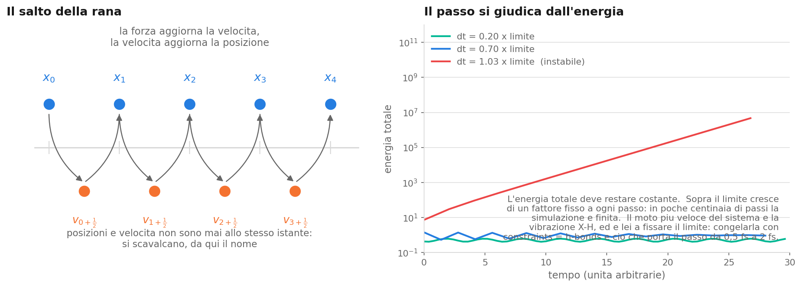

# 07 — Produzione, e come renderla più veloce

**Tempo: 25 minuti.** Fai partire la simulazione nei primi due, poi leggi il
resto mentre lavora.

---

## La simulazione di produzione

```bash
gmx grompp -f ../mdp/md.mdp -c npt.gro -t npt.cpt -p topol.top -n index.ndx -o md.tpr
gmx mdrun -deffnm md -nt 2
```

**Questa volta non c'è `-r`**, perché non ci sono vincoli posizionali: il
`.mdp` non ha la riga `define`. Il soluto è libero per la prima volta dalla
pagina 05. È questo che rende questa traiettoria degna di analisi e le due
precedenti no: tutto ciò che è venuto prima era il sistema che si riprendeva da
come è stato costruito.

Su due thread ci vogliono circa **16 minuti** per 250 ps. Lasciala andare e
continua a leggere.

### Che cosa cambia nel .mdp di produzione

```
nsteps             = 125000      ; 250 ps con dt = 0.002
nstxout-compressed = 1000        ; un fotogramma ogni 2 ps -> 125 fotogrammi
compressed-x-grps  = Protein_JZ4
continuation       = yes
gen-vel            = no
```

`compressed-x-grps = Protein_JZ4` scrive nella traiettoria **solo la proteina e
il ligando**. L'acqua è il 92 % degli atomi e a nessuna analisi della pagina 08
serve, quindi il file `.xtc` diventa dodici volte più piccolo: circa 1 MB
invece di 13. Pensa a che cosa analizzerai davvero prima di decidere che cosa
salvare. Scrivere l'intero sistema ogni 100 passi darebbe 250 MB per questi
250 ps — e 100 GB per una simulazione da 100 ns, che è il modo in cui si riempie
un filesystem per sbaglio.

> **250 ps è una durata didattica, non scientifica.** Una catena laterale ruota
> sulla scala del nanosecondo; un'ansa si riarrangia in decine o centinaia di
> nanosecondi; un ligando si stacca in microsecondi. Quello che puoi
> legittimamente concludere da 250 ps è "il complesso è stabile e non si è
> disfatto niente", che è una cosa che vale la pena sapere ed è davvero la
> prima da controllare. Per tutto il resto usa `reference/`, che è venti volte
> più lunga — e ricorda che anche 5 ns sono pochi.

---

## Renderla più veloce

Tutto quello che segue riguarda la stessa fisica eseguita in meno tempo.
Nessuna di queste cose cambia il risultato. (Se una modifica alle impostazioni
cambia il risultato, non è un'impostazione di prestazioni: è un'altra
simulazione.)

### Come avanza, un passo alla volta

Prima di parlare di velocità conviene sapere che cosa `mdrun` sta facendo
duecentomila volte di fila.



L'integratore `md` del file `.mdp` è il **salto della rana** (*leap-frog*):
posizioni e velocità non vengono mai calcolate nello stesso istante, ma
sfalsate di mezzo passo. È una scelta che costa nulla e rende l'integrazione
molto più stabile.

Il grafico a destra spiega perché il passo non si può alzare a piacere. Un
integratore di questo tipo conserva l'energia solo finché il passo resta sotto
una soglia legata al moto **più veloce** presente nel sistema. Sopra quella
soglia l'energia non va un po' fuori: cresce di un fattore fisso a ogni passo,
e la simulazione finisce in pochi istanti. Nel nostro sistema il moto più
veloce è la vibrazione di un legame X–H, ed è esattamente quello che
`constraints = h-bonds` congela — ed è per questo che possiamo usare 2 fs
invece di 0,5.

---

### Regola zero: misura

Ogni `mdrun` stampa la propria velocità verso la fine del log:

```bash
tail -6 md.log
```

```
               Core t (s)   Wall t (s)        (%)
       Time:     1910.803      955.401      200.0
                 (ns/day)    (hour/ns)    (ms/step)  (Matom*steps/s)
Performance:       22.609        1.062        7.643            4.368
```

(`tail -2` non basta: le ultime due righe sono `Finished mdrun` e una riga
vuota.)

**ns/day** è il numero che conta. Per provare un'impostazione senza eseguire
un'intera simulazione, fai qualche migliaio di passi e ignora i primi mille,
mentre il bilanciamento del carico si assesta:

```bash
gmx mdrun -s md.tpr -deffnm bench -nsteps 4000 -resetstep 1000 -nt 4 -noconfout
```

`-noconfout` evita di scrivere la struttura finale; `-resetstep 1000` fa
ripartire il cronometro al passo 1000.

### Dove va a finire il tempo

Sopra la riga delle prestazioni, il log ha una tabella come questa:

```
      R E A L   C Y C L E   A N D   T I M E   A C C O U N T I N G

 Activity:              Num   Num      Call    Wall time     Giga-Cycles
                        Ranks Threads  Count      (s)        total sum    %
----------------------------------------------------------------------------
 Domain decomp.            1   32       1001       1.561       139.899   2.4
 Neighbor search           1   32       1001       2.297       205.848   3.5
 Force                     1   32      50001      36.561      3275.865  56.2
 PME mesh                  1   32      50001      18.958      1698.620  29.2
 NB X/F buffer ops.        1   32     100002       2.473       221.544   3.8
 Update                    1   32      50001       0.966        86.572   1.5
 Constraints               1   32      50003       1.828       163.799   2.8
```

**Le forze a corto raggio (56 %) e la griglia PME (29 %) sono l'85 % del
costo**; tutto il resto è errore di arrotondamento. Questo ti dice dove
l'ottimizzazione può servire — e, cosa altrettanto utile, dove non può.
Ottimizzare l'algoritmo dei vincoli sarebbe lavoro speso sul 2,8 % della
simulazione.

---

### Le leve, in ordine di quanto valgono

#### 1. I thread — e la trappola `-nt` / `-ntomp`

Misurato su Bombina, su questo esatto sistema (33 382 atomi, passo da 2 fs,
nessuna GPU):

| `-nt` | ns/day | 250 ps in | efficienza per thread |
|---:|---:|---:|---:|
| 2 | 22,6 | 16 min | 100 % |
| 4 | 43,4 | 8 min | 96 % |
| 8 | 74,9 | 5 min | 83 % |
| 16 | 123,4 | 3 min | 68 % |
| 32 | 134,0 | 2,7 min | 37 % |

Due cose da leggere in quella tabella.

**Lo scaling è sublineare e peggiora.** Passare da 16 a 32 thread compra il 9 %
di velocità in più per il doppio dell'hardware, perché 32 è il conteggio
*hyper-threaded*: i core reali sono solo 16, e il secondo thread su un core ne
condivide le unità aritmetiche. Oltre 16, stai pagando soprattutto il
coordinamento.

**Il che significa che la macchina rende di più quando è divisa fra molti.**
Fai il conto: sedici studenti a due thread ciascuno fanno 16 × 22,6 = 362
ns/day in tutto. Uno studente che si prende tutti e 32 i thread ne fa 134. I
core non sono del tutto indipendenti — si contendono la memoria — quindi i 362
sono una stima ottimistica. Ma il confronto resta nettissimo, ed è il motivo
per cui la guida chiede `-nt 2`.

E la trappola, che vale la pena ripetere:

```bash
gmx mdrun -ntomp 2    # -> "Using 16 MPI threads, 2 OpenMP threads per tMPI thread"
gmx mdrun -nt 2       # -> "Using 1 MPI thread, 2 OpenMP threads"
```

`-ntomp` imposta i thread *per rank* e lascia a `mdrun` la scelta del numero di
rank — che sceglie riempiendo la macchina. **`-nt` è il totale.** Controlla
all'inizio del tuo `.log` che cosa hai ottenuto davvero.

#### 2. Ripartizione della massa degli idrogeni — il guadagno singolo più grande

Il passo temporale è limitato dal moto più veloce del sistema. Con
`constraints = h-bonds` lo *stiramento* X–H è congelato, ma la *piegatura* X–H
e la rotazione di gruppi come metile e ossidrile si muovono ancora in fretta,
perché l'idrogeno è leggero.

Allora rendilo più pesante. La **ripartizione della massa degli idrogeni**
(*hydrogen mass repartitioning*) sposta massa da ciascun atomo pesante agli
idrogeni a esso legati. La massa totale non cambia, la termodinamica non cambia
— la distribuzione di Boltzmann delle *posizioni* non dipende affatto dalle
masse — ma i moti più veloci rallentano, e il passo temporale può raddoppiare.

In GROMACS 2024 e successivi è una riga nel `.mdp`:

```
mass-repartition-factor = 3     ; gli idrogeni prendono 3 volte la loro massa
dt                      = 0.004 ; e il passo può raddoppiare
```

Provala:

```bash
sed -e 's/^dt .*/dt = 0.004/' -e 's/^nsteps .*/nsteps = 62500/' \
    -e '/^dt/a mass-repartition-factor = 3' ../mdp/md.mdp > md_hmr.mdp
gmx grompp -f md_hmr.mdp -c npt.gro -t npt.cpt -p topol.top -n index.ndx -o hmr.tpr
gmx mdrun -s hmr.tpr -deffnm bench_hmr -nsteps 4000 -resetstep 1000 -nt 2 -noconfout
```

Il costo per passo è identico, quindi l'accelerazione è il rapporto fra i passi
temporali. Misurato su Bombina, entrambi a `-nt 2` sotto lo stesso carico:

```
  base (dt = 2 fs)                    12,7 ns/day
  mass-repartition-factor 3, 4 fs     24,2 ns/day     1,9x
```

**Non** è gratis. Gli idrogeni adesso hanno la massa sbagliata, quindi la loro
dinamica propria è fittizia: tutto ciò che dipende dalla *cinetica* degli
idrogeni — spettri vibrazionali, effetti isotopici cinetici, moti protonici
molto veloci — è fuori discussione. Le proprietà di equilibrio e il
campionamento conformazionale non ne risentono, ed è per questo che è pratica
standard nel lavoro di produzione.

(I numeri assoluti qui sopra sono più bassi di quelli della tabella della leva
1 perché la macchina era occupata quando li ho presi. È proprio per questo che
si confrontano due misure fatte di seguito sulla stessa macchina, e mai un
numero di oggi contro uno della settimana scorsa.)

#### 3. Fissare i thread ai core

```bash
gmx mdrun -deffnm md -nt 2 -pin on
```

Per impostazione predefinita il sistema operativo è libero di spostare i tuoi
thread da un core all'altro. Lo fa, e ogni spostamento butta via la cache.
`-pin on` inchioda ciascun thread a un core. Vale qualche punto percentuale, di
più quando la macchina è occupata — e lo è.

Se più persone fissano i thread contemporaneamente, devono usare core diversi:
`-pinoffset 0`, `-pinoffset 2`, `-pinoffset 4`, …

#### 4. Lascia lavorare il sintonizzatore di PME

`-tunepme` è **attivo per impostazione predefinita** e va lasciato attivo.

PME divide il lavoro in due metà (pagina 05): una si calcola nello spazio
normale, l'altra su una griglia. Quanto lavoro tocca a ciascuna dipende da dove
metti il confine fra le due, cioè da `rcoulomb`. Nei primi qualche migliaio di
passi `mdrun` prova a spostare quel confine — allargando il raggio e diradando
la griglia insieme — finché le due metà non impiegano lo stesso tempo.
L'accuratezza non cambia: cambia solo come il lavoro è ripartito.

Le conseguenze pratiche:

- Non "ottimizzare" `rcoulomb` o `fourierspacing` a mano. Il sintonizzatore lo
  fa meglio, a tempo di esecuzione, per la macchina su cui si trova.
- **I numeri di benchmark presi nei primi qualche migliaio di passi non
  significano niente**, ed è a questo che serve `-resetstep`.

#### 5. Frequenza di aggiornamento della lista dei vicini

```
nstlist = 20     ; nel .mdp, oppure -nstlist 40 da riga di comando
```


Ricostruire la lista dei vicini costa tempo; farlo meno spesso significa che la
lista deve coprire più terreno, quindi il margine cresce e ogni valutazione
delle forze copre più coppie. Un ottimo esiste, e dipende dalla macchina. Con
`verlet-buffer-tolerance` impostato, **GROMACS regola il margine
automaticamente**, quindi alzare `nstlist` è sicuro: scambia ricostruzioni
della lista con una lista leggermente più grande, senza cambiare
l'accuratezza. Sui processori il valore predefinito è di solito vicino a quello
giusto; sulle GPU vincono valori molto più alti. Prova 40 e misura.

#### 6. Decisioni che hai già preso

Due dei risparmi più grandi di questa esercitazione sono avvenuti prima che
partisse qualunque dinamica:

- **il dodecaedro rombico** (pagina 04) — 29 % di molecole d'acqua in meno
  rispetto a un cubo, a parità di distanza minima fra immagini;
- **`constraints = h-bonds`** — senza, il passo sarebbe 0,5 fs invece di 2 fs,
  un fattore quattro.

La dimensione del sistema è il termine dominante del costo, ed è fissata in
fase di preparazione. **La simulazione più economica è quella che non hai reso
inutilmente grande.**

#### 7. Che cosa non fare

| | |
|---|---|
| ridurre `rcoulomb` per andare più veloce | PME compensa; non guadagni niente e rischi di violare la convenzione dell'immagine minima |
| `coulombtype = cut-off` | veloce, e sbagliato (pagina 05) |
| togliere l'acqua | l'acqua *è* la fisica; il solvente implicito è un altro metodo, con altri modi di sbagliare |
| chiedere tutti e 32 i thread su una macchina condivisa | il 9 % più veloce per te, metà velocità per tutti gli altri |

---

## Se la simulazione si interrompe

Ogni `mdrun` scrive un checkpoint (`md.cpt`) ogni 15 minuti. Per continuare:

```bash
gmx mdrun -deffnm md -nt 2 -cpi md.cpt
```

Riprende dallo stato esatto — posizioni, velocità, termostato, barostato, flusso
dei numeri casuali — quindi il risultato è bit per bit quello che avrebbe dato
una simulazione ininterrotta. Puoi anche fermarla in modo pulito a un limite di
tempo con `-maxh 0.5` (mezz'ora): scriverà il checkpoint e uscirà invece di
essere uccisa a metà scrittura.

---

## Quando finisce

```bash
tail -6 md.log
ls -la md.xtc
```

Dovresti avere un `md.xtc` di circa 1 MB, con 125 fotogrammi di 2636 atomi.
Conserva anche `md.tpr`: l'analisi ha bisogno di entrambi.

---

Avanti: [08 — Analisi](08-analisi.md)
